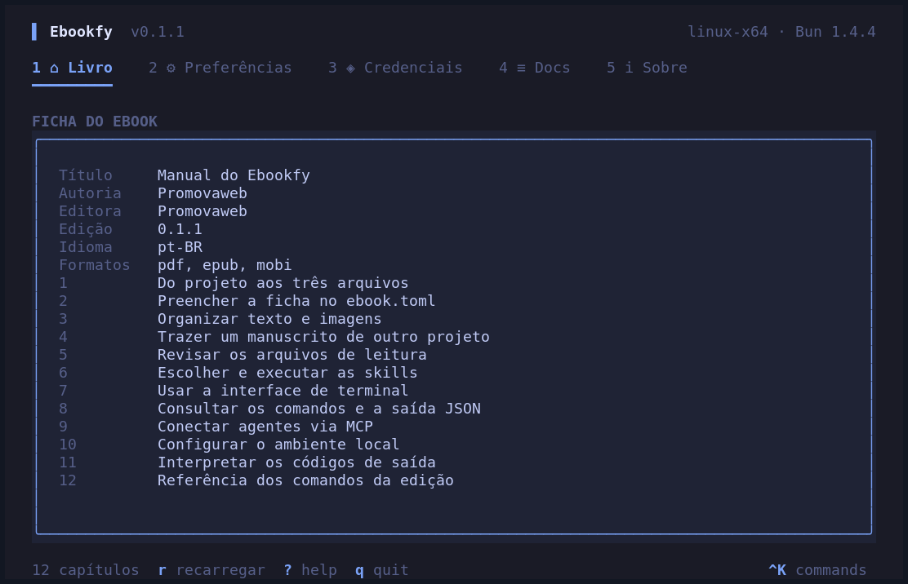
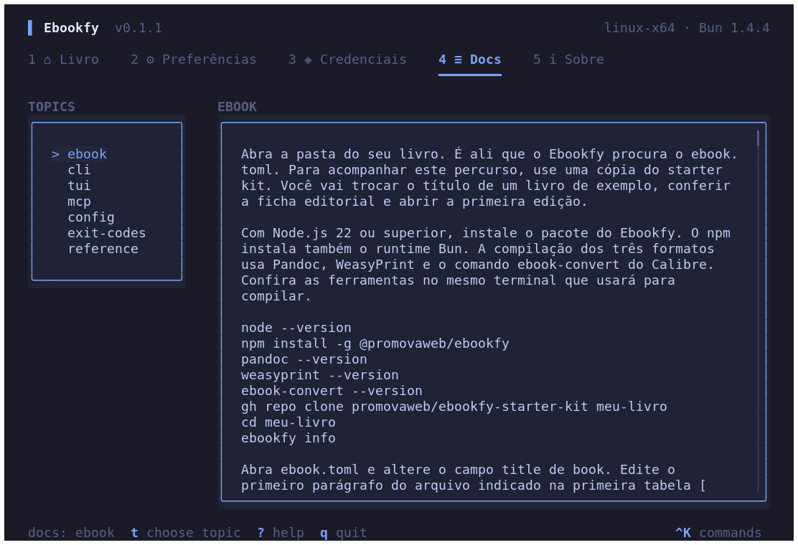

# Usar a interface de terminal

Abra um terminal na pasta do livro ou dentro de um capítulo e execute `ebookfy`. Para abrir diretamente a ficha quando sua preferência inicial aponta para outra aba, use `ebookfy tui --tab overview`. O aplicativo lê o TOML do projeto e os títulos dos arquivos de capítulo.

Na captura, a aba **Livro** está selecionada. A primeira linha do terminal identifica o aplicativo e seu runtime. Dentro do quadro, **Edição** pertence ao livro. A lista numerada reproduz a ordem declarada em `[[chapters]]`, e o rodapé informa a quantidade de capítulos carregados.

## Conferir uma alteração durante a escrita

Mantenha a TUI aberta e edite o título de um capítulo em outro terminal ou no editor. Salve o arquivo, volte à aba Livro e pressione `r`. Confira o novo título na mesma posição da lista. Depois, mova a tabela desse capítulo no TOML e salve. A aba acompanha mudanças na configuração e permite conferir a nova ordem antes de compilar.

| Ação | Atalho |
| --- | --- |
| Abrir Livro, Preferências, Credenciais, Docs ou Sobre | Teclas de `1` a `5`, conforme a barra superior |
| Avançar ou voltar uma aba | Setas direita e esquerda ou `]` e `[` |
| Alternar o foco entre painéis | `Tab` e `Shift+Tab` |
| Abrir a lista de comandos da interface | `Ctrl+K` ou `:` |
| Ver a ajuda de teclado e mouse | `?` |
| Fechar um diálogo | `Esc` |
| Sair da TUI | `q` na tela principal |

## Consultar o manual sem sair do terminal

Pressione `4` para abrir **Docs** ou execute `ebookfy tui --tab docs` diretamente no terminal. Use `t` para escolher um tópico. As setas para cima e para baixo percorrem o texto. `PageUp` e `PageDown` percorrem trechos maiores. Consulte o tópico de configuração para ajustar preferências pessoais ou a referência de comandos para conferir argumentos e opções.

Em um script, use `ebookfy info --json` para ler a ficha sem abrir a TUI. A opção é apropriada para uma etapa de integração contínua que precisa extrair a lista de capítulos ou os formatos antes do build.

O tópico `ebook` reúne os guias de instalação, configuração, capítulos, migração, exportação e skills editoriais. Ele acompanha o aplicativo instalado. Você pode consultá-lo mesmo que apenas o manuscrito e o CLI estejam disponíveis na máquina.
